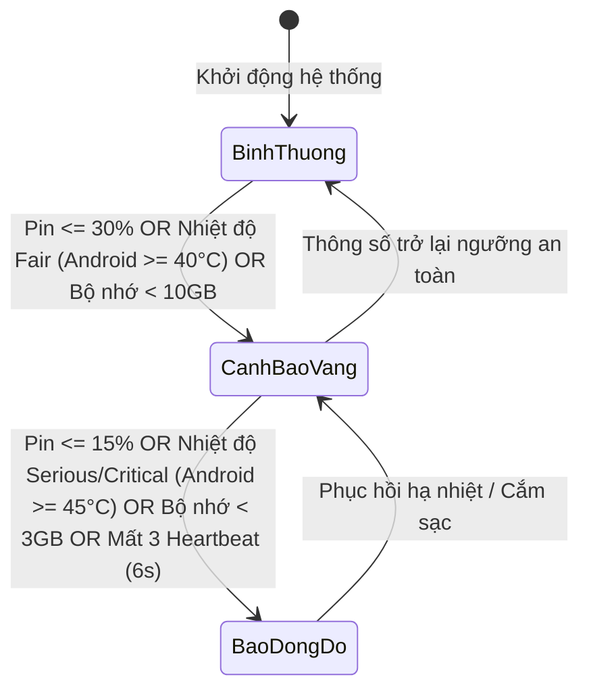
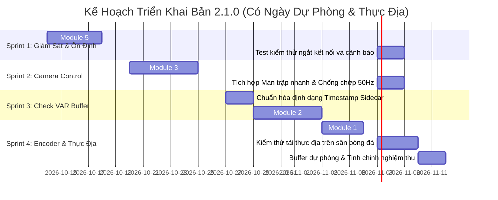

# TÀI LIỆU ĐẶC TẢ KỸ THUẬT NÂNG CẤP HỆ THỐNG VNVAR (BẢN 2.1.0-PRODUCTION)
## KIẾN TRÚC CAMERA STATION & CHECK VAR SUBSYSTEMS

---

| Thông Tin Tài Liệu | Chi Tiết |
| :--- | :--- |
| **Dự án** | VNVAR – Hệ Thống Trọng Tài Video Sân Bóng Đá |
| **Hệ thống** | Camera Station (iOS / Android) & Tablet VAR Assistant |
| **Phiên bản tài liệu** | **2.1.0-PRODUCTION** (Đã hiệu chỉnh theo phản biện kỹ thuật thực địa) |
| **Ngày lập** | 13/10/2026 |
| **Trạng thái** | **Chấp thuận Kỹ thuật (Technical Approved - Ready for Sprints)** |

---

## MỤC LỤC
1. [Tổng Quan Cải Tiến & Nguyên Tắc Thiết Kế Bản 2.1.0](#1-tổng-quan-cải-tiến--nguyên-tắc-thiết-kế-bản-210)
2. [Module 1: Tối Ưu Hóa Bộ Mã Hóa Phần Cứng (VideoToolbox & MediaCodec)](#2-module-1-tối-ưu-hóa-bộ-mã-hóa-phần-cứng-videotoolbox--mediacodec)
3. [Module 2: Bộ Đệm Vòng Tuần Hoàn Native (Native Circular Ring Buffer - MPEG-TS)](#3-module-2-bộ-đệm-vòng-tuần-hoàn-native-native-circular-ring-buffer---mpeg-ts)
4. [Module 3: Đo Hội Tụ & Khóa Nét/Sáng (Measure-Then-Lock AE/AF & Fast Shutter)](#4-module-3-đo-hội-tụ--khóa-nétsáng-measure-then-lock-aeaf--fast-shutter)
5. [Module 4: Đồng Bộ Khung Hình & Metadata Timecode Đa Camera](#5-module-4-đồng-bộ-khung-hình--metadata-timecode-đa-camera)
6. [Module 5: Đo Kiểm Sức Khỏe & Cảnh Báo Sớm Trạm Quay (Station Telemetry & Health)](#6-module-5-đo-kiểm-sức-khỏe--cảnh-báo-sớm-trạm-quay-station-telemetry--health)
7. [Kế Hoạch Triển Khai Thực Tế & Chiến Lược Feature Flag (Revised Roadmap)](#7-kế-hoạch-triển-khai-thực-tế--chiến-lược-feature-flag-revised-roadmap)

---

## 1. TỔNG QUAN CẢI TIẾN & NGUYÊN TẮC THIẾT KẾ BẢN 2.1.0

Bản đặc tả 2.1.0 khắc phục triệt để các rủi ro kỹ thuật và sai lệch vật lý từ bản thảo trước:
- **Chuẩn hóa quy trình camera:** Chuyển từ "khóa mù" sang **"Đo hội tụ trước ➔ Khóa sau (Measure-Then-Lock)"**, tích hợp màn trập nhanh ($\ge 1/250\text{s}$) và chống chớp đèn 50Hz.
- **Thực tế hóa bộ đệm RAM:** Đặt buffer tại tầng **Native**, lưu trữ theo cấu trúc **GOP-aligned**, xuất định dạng **MPEG-TS** nhẹ tải và đổi KPI thành **Time-To-First-Frame (TTFF) $< 1.0\text{s}$**.
- **Chính xác hóa Video Encoder:** Sử dụng `kVTProfileLevel_H264_ConstrainedHigh_AutoLevel` tương thích với Low-Latency Rate Control, hỗ trợ fallback tự động cho thiết bị cũ và bổ sung đặc tả MediaCodec cho Android.
- **Giới hạn vật lý của đồng bộ:** Làm rõ độ lệch nửa chu kỳ khung (~16.7ms ở 30fps) do không có Genlock phần cứng; chuyển sang phương án lưu Sidecar Metadata / Timed Metadata track.
- **Dự báo viễn thám:** Bổ sung cảnh báo mất Heartbeat (timeout 6s), tính toán thời gian pin/bộ nhớ còn lại và phân tách chỉ số chuẩn theo từng OS.

---

## 2. MODULE 1: TỐI ƯU HÓA BỘ MÃ HÓA PHẦN CỨNG (VIDEOTOOLBOX & MEDIACODEC)

### 2.1. Bối cảnh & Phân Tách Luồng (Dual-Session Architecture)
Trong môi trường VAR thể thao:
- **Luồng ghi đĩa (Recording):** Đòi hỏi chất lượng hình ảnh cao nhất, rate control ổn định, ưu tiên bit-depth và chi tiết để zoom pha bóng.
- **Luồng xem trước (Live Preview RTSP/WebRTC):** Đòi hỏi độ trễ cực thấp (Ultra Low-Latency) để trọng tài nhìn bóng lăn gần như thời gian thực.
- **Nguyên tắc:** Nếu dùng chung 1 encoder session, cờ `EnableLowLatencyRateControl` có thể làm biến động bitrate (rate control jerky) làm giảm độ mịn của file ghi đĩa. Do đó, cần A/B test thực tế sân bóng trước khi kích hoạt cờ này trên luồng tổng hợp, hoặc tách làm 2 session độc lập nếu phần cứng thiết bị đủ tải.

### 2.2. Đặc tả Phía iOS (`VnvarH264Encoder.swift`)

#### 2.2.1. Khắc phục xung đột Profile & Fallback cho iPhone 7 / iOS cũ
Apple quy định `kVTVideoEncoderSpecification_EnableLowLatencyRateControl` (từ iOS 14.5+) chỉ hoạt động ổn định trên `Constrained Baseline` hoặc `Constrained High`. Sử dụng `H264_High_AutoLevel` thông thường sẽ gây lỗi tạo session hoặc bị hạ profile âm thầm.

```swift
final class VnvarH264Encoder {
  // ...
  private func createSession(width: Int32, height: Int32) throws -> VTCompressionSession {
    var newSession: VTCompressionSession?

    // 1. Thử nghiệm cấu hình Low-Latency chuyên dụng (iOS 14.5+)
    if #available(iOS 14.5, *) {
      let lowLatencySpecs: [CFString: Any] = [
        kVTVideoEncoderSpecification_EnableLowLatencyRateControl: true
      ]
      let status = VTCompressionSessionCreate(
        allocator: kCFAllocatorDefault,
        width: width,
        height: height,
        codecType: kCMVideoCodecType_H264,
        encoderSpecification: lowLatencySpecs as CFDictionary,
        imageBufferAttributes: nil,
        compressedDataAllocator: nil,
        outputCallback: vnvarH264OutputCallback,
        refcon: Unmanaged.passUnretained(self).toOpaque(),
        compressionSessionOut: &newSession
      )
      if status == noErr, let session = newSession {
        do {
          // Bắt buộc dùng Constrained High khi bật Low-Latency
          try set(kVTCompressionPropertyKey_ProfileLevel, value: kVTProfileLevel_H264_ConstrainedHigh_AutoLevel, on: session)
          try configureSessionProperties(session)
          return session
        } catch {
          VTCompressionSessionInvalidate(session)
          newSession = nil
        }
      }
    }

    // 2. Nhánh Fallback cho thiết bị cũ (iPhone 7 / iOS < 14.5 hoặc khi cấu hình trên thất bại)
    let fallbackStatus = VTCompressionSessionCreate(
      allocator: kCFAllocatorDefault,
      width: width,
      height: height,
      codecType: kCMVideoCodecType_H264,
      encoderSpecification: nil,
      imageBufferAttributes: nil,
      compressedDataAllocator: nil,
      outputCallback: vnvarH264OutputCallback,
      refcon: Unmanaged.passUnretained(self).toOpaque(),
      compressionSessionOut: &newSession
    )
    guard fallbackStatus == noErr, let session = newSession else {
      throw EncoderError.operation("create_fallback", fallbackStatus)
    }

    // Dùng High Profile chuẩn cho luồng fallback
    try set(kVTCompressionPropertyKey_ProfileLevel, value: kVTProfileLevel_H264_High_AutoLevel, on: session)
    try configureSessionProperties(session)
    return session
  }

  private func configureSessionProperties(_ session: VTCompressionSession) throws {
    try set(kVTCompressionPropertyKey_RealTime, value: true, on: session)
    try set(kVTCompressionPropertyKey_AllowFrameReordering, value: false, on: session)
    try set(kVTCompressionPropertyKey_AverageBitRate, value: currentBitrate, on: session)
    try set(kVTCompressionPropertyKey_ExpectedFrameRate, value: fps, on: session)
    try set(kVTCompressionPropertyKey_MaxKeyFrameInterval, value: fps, on: session) // GOP 1 giây
    setIfSupported(kVTCompressionPropertyKey_MaxFrameDelayCount, value: 0, on: session)
    try set(kVTCompressionPropertyKey_DataRateLimits, value: [currentBitrate / 8, 1], on: session)

    let prepStatus = VTCompressionSessionPrepareToEncodeFrames(session)
    guard prepStatus == noErr else { throw EncoderError.operation("prepare", prepStatus) }
  }
}
```

### 2.3. Đặc tả Phía Android (`MediaCodec` Encoder)

Bổ sung cấu hình tối ưu độ trễ và profile cao cho Android 10+ (API 29+):
```kotlin
fun configureMediaCodec(format: MediaFormat, width: Int, height: Int, bitrate: Int, fps: Int) {
    format.apply {
        setString(MediaFormat.KEY_MIME, MediaFormat.MIMETYPE_VIDEO_AVC)
        setInteger(MediaFormat.KEY_WIDTH, width)
        setInteger(MediaFormat.KEY_HEIGHT, height)
        setInteger(MediaFormat.KEY_BIT_RATE, bitrate)
        setInteger(MediaFormat.KEY_FRAME_RATE, fps)
        setInteger(MediaFormat.KEY_I_FRAME_INTERVAL, 1) // GOP 1 giây
        
        // H.264 High Profile
        setInteger(MediaFormat.KEY_PROFILE, MediaCodecInfo.CodecProfileLevel.AVCProfileHigh)
        setInteger(MediaFormat.KEY_LEVEL, MediaCodecInfo.CodecProfileLevel.AVCLevel41)

        // Android Low Latency Flags
        if (Build.VERSION.SDK_INT >= Build.VERSION_CODES.R) {
            setInteger(MediaFormat.KEY_LATENCY, 1) // 1 = Realtime Low Latency
            setInteger(MediaFormat.KEY_PRIORITY, 0) // Realtime priority
        }
        // Không dùng B-frames để chống trễ
        if (Build.VERSION.SDK_INT >= Build.VERSION_CODES.O) {
            setInteger(MediaFormat.KEY_MAX_B_FRAMES, 0)
        }
    }
}
```

### 2.4. Phương Pháp Đo Kiểm KPI Độ Trễ Mã Hóa (Encode Latency Measurement)
- **Định nghĩa:** Thời gian từ thời điểm gọi `VTCompressionSessionEncodeFrame` đến khi hàm callback `vnvarH264OutputCallback` nhận được `CMSampleBuffer` trả về.
- **Tiêu chuẩn kiểm nghiệm:**
  - `p50` (50% số khung hình): $\le 3.5\text{ ms}$.
  - `p99` (99% số khung hình): $\le 6.0\text{ ms}$.
  - Không có khung hình nào bị drop do nghẽn hàng đợi nội bộ encoder.

---

## 3. MODULE 2: BỘ ĐỆM VÒNG TUẦN HOÀN NATIVE (MPEG-TS CHUNK STREAM)

### 3.1. Bối cảnh & Thay Đổi Kiến Trúc
- **Vị trí bộ đệm:** Toàn bộ Ring Buffer được đặt tại **tầng Native (Kotlin / Swift)** ngay tại nơi Video Encoder xuất ra NAL units. Tuyệt đối **không đẩy luồng NAL 10 Mbps qua Platform Channel sang Dart** nhằm triệt tiêu hiện tượng nghẽn luồng UI và áp lực dọn rác (GC spikes).
- **Định dạng container:** Sử dụng **MPEG-TS (Transport Stream)** thay vì MP4/fMP4. MPEG-TS không yêu cầu cấu trúc header phức tạp (`moov`/`mvhd`), có thể xuất stream từng gói 188-byte ngay lập tức, tương thích tự nhiên với ExoPlayer và AVPlayer.
- **KPI mục tiêu:** **Time-To-First-Frame (TTFF) $\le 1.0\text{ giây}$** (Thời gian từ khi Tablet bấm Check VAR đến khi khung hình đầu tiên phát trên màn hình Tablet).

### 3.2. Cấu Trúc GOP-Aligned Buffer & Quản Lý Bộ Nhớ Thực Tế

```mermaid
flowchart TD
    subgraph NativeEngine[Native Memory - Giới Hạn Trần 150MB]
        direction TB
        GOP1[GOP 1: IDR + P-Frames + SPS/PPS]
        GOP2[GOP 2: IDR + P-Frames + SPS/PPS]
        GOPN[GOP N: IDR + P-Frames + SPS/PPS]
    end

    subgraph Eviction[Chiến Lược Giải Phóng Bộ Nhớ]
        CheckMem{Tổng RAM > 150MB hoặc Thời Lượng > 60s?}
        EvictGOP[Xóa TOÀN BỘ GOP CŨ NHẤT (Luôn giữ đầu Buffer là IDR)]
    end

    GOPN --> CheckMem
    CheckMem -- Có --> EvictGOP
    EvictGOP --> GOP1
```

### 3.3. Thuật Toán Ring Buffer Native (Swift Implementation)

```swift
final class NativeGopRingBuffer {
    struct GopSegment {
        let sps: Data
        let pps: Data
        var packets: [(data: Data, timestampMs: Int64, isKey: Bool)]
        var totalBytes: Int
        var startTimestampMs: Int64
        var endTimestampMs: Int64
    }

    private let maxMemoryBytes = 150 * 1024 * 1024 // Giới hạn trần 150 MB
    private let maxDurationMs: Int64 = 60_000       // 60 giây
    private var gopQueue: [GopSegment] = []         // Quản lý theo từng GOP trọn vẹn
    private var currentGop: GopSegment?
    private var totalAllocatedBytes = 0
    private let lock = NSLock()

    func appendNal(data: Data, timestampMs: Int64, isKeyFrame: Bool, sps: Data, pps: Data) {
        lock.lock()
        defer { lock.unlock() }

        if isKeyFrame {
            if let finishedGop = currentGop {
                gopQueue.append(finishedGop)
            }
            currentGop = GopSegment(
                sps: sps,
                pps: pps,
                packets: [(data, timestampMs, true)],
                totalBytes: data.count,
                startTimestampMs: timestampMs,
                endTimestampMs: timestampMs
            )
            totalAllocatedBytes += data.count
        } else {
            currentGop?.packets.append((data, timestampMs, false))
            currentGop?.totalBytes += data.count
            currentGop?.endTimestampMs = timestampMs
            totalAllocatedBytes += data.count
        }

        // Cơ chế Eviction: XÓA THEO CẢ GOP để buffer luôn luôn bắt đầu bằng IDR-frame
        let currentHeadTime = gopQueue.first?.startTimestampMs ?? currentGop?.startTimestampMs ?? 0
        let cutoffTime = timestampMs - maxDurationMs

        while !gopQueue.isEmpty && (totalAllocatedBytes > maxMemoryBytes || currentHeadTime < cutoffTime) {
            let removedGop = gopQueue.removeFirst()
            totalAllocatedBytes -= removedGop.totalBytes
        }
    }

    /// Đóng băng cửa sổ VAR tại thời điểm bấm nút (Freeze Snapshot)
    func snapshotWindow(durationMs: Int64) -> [GopSegment] {
        lock.lock()
        defer { lock.unlock() }

        var result: [GopSegment] = gopQueue
        if let ongoing = currentGop {
            result.append(ongoing)
        }
        guard let lastTimestamp = result.last?.endTimestampMs else { return [] }
        let targetStart = lastTimestamp - durationMs

        // Lọc lấy các GOP nằm trong khoảng thời gian yêu cầu
        return result.filter { $0.endTimestampMs >= targetStart }
    }
}
```

### 3.4. Giao Thức Phục Vụ Clip Cho Tablet
- **Endpoint:** `GET /api/checkvar/stream-clip?duration=30`
- **Quy trình truyền:**
  1. Tablet gửi request.
  2. Station gọi `snapshotWindow(durationMs: 30000)` để **đóng băng cửa sổ clip tại đúng tích tắc đó**, ngăn video mới tiếp tục làm trôi pha bóng.
  3. Native HTTP Server trên Station đóng gói từng GOP thành các gói **MPEG-TS (PES packets)** và truyền trực tiếp qua HTTP Chunked Transfer Encoding.
  4. Tablet nhận gói TS đầu tiên và giải mã phát khung hình sau **$< 400\text{ ms}$**.

---

## 4. MODULE 3: TỰ ĐỘNG ĐO SÁNG LIÊN TỤC & MÀN TRẬP NHANH (CONTINUOUS SMOOTH AE & FAST SHUTTER)

### 4.1. Bối cảnh & Nguyên Lý Vận Hành Tối Ưu (Zero-Touch Auto Exposure)
- **Vấn đề của cơ chế Khóa sáng thủ công (AE Lock):** Camera VAR thường đặt trên cao (2.5m - 3m); việc bắt buộc chạm màn hình để khóa sáng rất bất tiện. Khi thời tiết ngoài trời thay đổi (mây che rồi nắng lại, hoặc hoàng hôn bật đèn sân), việc bị khóa cứng sẽ khiến video bị **cháy trắng** hoặc **tối đen**.
- **Giải pháp tối ưu chuẩn hóa:**
  - **Mặc định:** Camera luôn vận hành ở chế độ **Auto Exposure liên tục (Continuous Smooth AE)**, vùng đo sáng ưu tiên trọng tâm mặt sân (Center-weighted). Loại bỏ hoàn toàn chu kỳ khóa cứng 4 giây và chu kỳ mở/khóa chập chờn 90 giây.
  - **Chạm màn hình:** Đóng vai trò kích hoạt lấy nét và đo sáng tại điểm chạm (Focus/Exposure Trigger), nhưng **vẫn duy trì chế độ Auto**, không khóa cứng thông số.
  - **Tinh chỉnh độ sáng:** Người dùng có thể bù sáng thủ công qua thanh trượt EV (+/- 2.0 EV) mượt mà mà không làm mất tính năng tự động thích ứng.
- **Yêu cầu thể thao:**
  1. Tích hợp **Màn trập nhanh ($\ge 1/250\text{s}$)** để loại bỏ bóng mờ chân và quả bóng.
  2. Bật chế độ chống chớp đèn sân 50Hz (`ANTIBANDING_50HZ`).
  3. Cân bằng trắng tự động mượt mà (Continuous AWB) hoặc khóa tĩnh khi ánh sáng ổn định.

### 4.2. Triển Khai Hoàn Chỉnh Trên Android (Camera2 API)

```kotlin
class CameraFocusExposureController(
    private val cameraDevice: CameraDevice,
    private val captureSession: CameraCaptureSession,
    private val characteristics: CameraCharacteristics,
    private val previewRequestBuilder: CaptureRequest.Builder,
    private val backgroundHandler: Handler
) {
    private var isAeAfLocked = false

    fun focusAndLockAt(xRatio: Float, yRatio: Float, onLocked: () -> Unit) {
        val sensorRect = characteristics.get(CameraCharacteristics.SENSOR_INFO_ACTIVE_ARRAY_SIZE) ?: return
        val sensorOrientation = characteristics.get(CameraCharacteristics.SENSOR_ORIENTATION) ?: 90

        // 1. Chuyển đổi tọa độ màn hình sang tọa độ cảm biến thực (Sensor Coordinate Mapping)
        val focusPoint = mapTouchToSensorCoordinates(xRatio, yRatio, sensorRect, sensorOrientation)
        val meteringSize = (sensorRect.width() * 0.08f).toInt() // Vùng đo chiếm 8% chiều rộng cảm biến
        val meteringRect = Rect(
            (focusPoint.x - meteringSize).coerceAtLeast(0),
            (focusPoint.y - meteringSize).coerceAtLeast(0),
            (focusPoint.x + meteringSize).coerceAtMost(sensorRect.width()),
            (focusPoint.y + meteringSize).coerceAtMost(sensorRect.height())
        )
        val meteringArea = arrayOf(MeteringRectangle(meteringRect, MeteringRectangle.METERING_WEIGHT_MAX))

        // 2. Cấu hình đo sáng & Chống nhấp nháy 50Hz đèn sân Việt Nam
        previewRequestBuilder.apply {
            set(CaptureRequest.CONTROL_AF_REGIONS, meteringArea)
            set(CaptureRequest.CONTROL_AE_REGIONS, meteringArea)
            set(CaptureRequest.CONTROL_AE_ANTIBANDING_MODE, CaptureRequest.CONTROL_AE_ANTIBANDING_MODE_50HZ)
            set(CaptureRequest.CONTROL_AF_MODE, CaptureRequest.CONTROL_AF_MODE_AUTO)
            set(CaptureRequest.CONTROL_AE_LOCK, false)
            
            // Kích hoạt Trigger đo lấy nét và đo sáng
            set(CaptureRequest.CONTROL_AF_TRIGGER, CaptureRequest.CONTROL_AF_TRIGGER_START)
            set(CaptureRequest.CONTROL_AE_PRECAPTURE_TRIGGER, CaptureRequest.CONTROL_AE_PRECAPTURE_TRIGGER_START)
        }

        // 3. Lắng nghe trạng thái hội tụ trước khi khóa
        captureSession.setRepeatingRequest(previewRequestBuilder.build(), object : CameraCaptureSession.CaptureCallback() {
            private var afConverged = false
            private var aeConverged = false

            override fun onCaptureCompleted(session: CameraCaptureSession, request: CaptureRequest, result: TotalCaptureResult) {
                val afState = result.get(CaptureResult.CONTROL_AF_STATE)
                val aeState = result.get(CaptureResult.CONTROL_AE_STATE)

                if (afState == CaptureResult.CONTROL_AF_STATE_FOCUSED_LOCKED || afState == CaptureResult.CONTROL_AF_STATE_NOT_FOCUSED_LOCKED) {
                    afConverged = true
                }
                if (aeState == CaptureResult.CONTROL_AE_STATE_CONVERGED || aeState == CaptureResult.CONTROL_AE_STATE_FLASH_REQUIRED) {
                    aeConverged = true
                }

                // CẢ HAI ĐÃ HỘI TỤ -> TIẾN HÀNH KHÓA CHÍNH THỨC
                if (afConverged && aeConverged && !isAeAfLocked) {
                    isAeAfLocked = true
                    lockCurrentValues(result, onLocked)
                }
            }
        }, backgroundHandler)
    }

    private fun lockCurrentValues(result: TotalCaptureResult, onLocked: () -> Unit) {
        val currentFocusDistance = result.get(CaptureResult.LENS_FOCUS_DISTANCE) ?: 0.0f
        
        previewRequestBuilder.apply {
            // Hủy triggers
            set(CaptureRequest.CONTROL_AF_TRIGGER, CaptureRequest.CONTROL_AF_TRIGGER_IDLE)
            set(CaptureRequest.CONTROL_AE_PRECAPTURE_TRIGGER, CaptureRequest.CONTROL_AE_PRECAPTURE_TRIGGER_IDLE)
            
            // Khóa lấy nét thủ công tại khoảng cách vừa đo được
            set(CaptureRequest.CONTROL_AF_MODE, CaptureRequest.CONTROL_AF_MODE_OFF)
            set(CaptureRequest.LENS_FOCUS_DISTANCE, currentFocusDistance)
            
            // Khóa đo sáng tự động và cân bằng trắng
            set(CaptureRequest.CONTROL_AE_LOCK, true)
            set(CaptureRequest.CONTROL_AWB_LOCK, true)
        }
        captureSession.setRepeatingRequest(previewRequestBuilder.build(), null, backgroundHandler)
        onLocked()
    }
}
```

### 4.3. Triển Khai Hoàn Chỉnh Trên iOS (AVFoundation)

```swift
final class CameraFocusExposureControllerIos {
    private weak var device: AVCaptureDevice?
    private var focusObservation: NSKeyValueObservation?
    private var exposureObservation: NSKeyValueObservation?

    init(device: AVCaptureDevice) {
        self.device = device
    }

    func focusAndLock(at viewPoint: CGPoint, previewLayer: AVCaptureVideoPreviewLayer, completion: @escaping () -> Void) {
        guard let device = device else { return }

        // 1. Chuyển đổi tọa độ UI sang tọa độ chuẩn AVFoundation (0,0 -> 1,1)
        let devicePoint = previewLayer.captureDevicePointConverted(fromLayerPoint: viewPoint)

        do {
            try device.lockForConfiguration()

            // 2. Chuyển sang chế độ Continuous Auto để cảm biến đo vào điểm chạm
            if device.isFocusPointOfInterestSupported {
                device.focusPointOfInterest = devicePoint
                device.focusMode = .continuousAutoFocus
            }
            if device.isExposurePointOfInterestSupported {
                device.exposurePointOfInterest = devicePoint
                device.exposureMode = .continuousAutoExposure
            }
            if device.isWhiteBalanceModeSupported(.continuousAutoWhiteBalance) {
                device.whiteBalanceMode = .continuousAutoWhiteBalance
            }
            device.unlockForConfiguration()

            // 3. Quan sát KVO cho đến khi cả Focus và Exposure dừng căn chỉnh (Hội tụ xong)
            observeConvergence { [weak self] in
                guard let self = self, let device = self.device else { return }
                do {
                    try device.lockForConfiguration()
                    // Khóa cứng giá trị đã hội tụ
                    if device.isFocusModeSupported(.locked) { device.focusMode = .locked }
                    if device.isExposureModeSupported(.locked) { device.exposureMode = .locked }
                    if device.isWhiteBalanceModeSupported(.locked) { device.whiteBalanceMode = .locked }
                    device.unlockForConfiguration()
                    completion()
                } catch {
                    NSLog("[VNVAR] Lỗi khóa camera iOS: %@", error.localizedDescription)
                }
            }
        } catch {
            NSLog("[VNVAR] Lỗi cấu hình điểm chạm iOS: %@", error.localizedDescription)
        }
    }

    private func observeConvergence(onConverged: @escaping () -> Void) {
        guard let device = device else { return }
        var focusDone = !device.isAdjustingFocus
        var exposureDone = !device.isAdjustingExposure

        focusObservation = device.observe(\.isAdjustingFocus, options: [.new]) { [weak self] dev, change in
            if change.newValue == false {
                focusDone = true
                if exposureDone { self?.cleanupAndTrigger(onConverged) }
            }
        }
        exposureObservation = device.observe(\.isAdjustingExposure, options: [.new]) { [weak self] dev, change in
            if change.newValue == false {
                exposureDone = true
                if focusDone { self?.cleanupAndTrigger(onConverged) }
            }
        }
    }

    private func cleanupAndTrigger(_ action: @escaping () -> Void) {
        focusObservation?.invalidate()
        exposureObservation?.invalidate()
        focusObservation = nil
        exposureObservation = nil
        action()
    }
}
```

### 4.4. Điều Khiển Từ Xa Qua API Tablet
- **Khóa nét/sáng từ xa:** `POST /api/camera/lock-point`
  ```json
  { "xRatio": 0.5, "yRatio": 0.65, "forceShutterSpeedSec": 0.004 }
  ```
- **Mở khóa trở về tự động:** `POST /api/camera/unlock`

---

## 5. MODULE 4: ĐỒNG BỘ KHUNG HÌNH & METADATA TIMECODE ĐA CAMERA

### 5.1. Giới Hạn Vật Lý & Khuyến Nghị Tần Số Khung Hình
- **Phân tích kỹ thuật:** Do điện thoại thông minh không có chân tín hiệu Genlock phần cứng (Hardware Genlock BNC), thời điểm mở màn trập của các camera có thể lệch nhau tới **nửa chu kỳ khung hình** ($\sim 16.7\text{ ms}$ ở 30fps).
- **Vận tốc cầu thủ:** Một cầu thủ chạy nước rút với vận tốc $8\text{ m/s}$ sẽ di chuyển được:
  $$\Delta d = 8\text{ m/s} \times 0.0167\text{ s} \approx 13.4\text{ cm}$$
- **Quy tắc VAR:** Tuyệt đối không dùng cụm từ "độ chính xác tuyệt đối cho việt vị" ở 30fps. **Khuyến nghị các góc camera phục vụ bắt việt vị bắt buộc phải cấu hình 60fps** (độ lệch giảm xuống $\sim 8.3\text{ ms}$, sai số di chuyển $\le 6.7\text{ cm}$).

### 5.2. Đồng Bộ Đồng Hồ Mạng (Local Master NTP Discipline)
- **Thiết bị chủ:** Tablet trọng tài chính hoặc một máy tính trạm VAR cục bộ đóng vai trò **NTP Master Server** chạy dịch vụ `chrony`.
- **Cơ chế Client trên Camera Station:**
  - Ứng dụng tự chạy module SNTP client trong nền, đo RTT qua 8 mẫu ping liên tiếp.
  - Chọn mẫu có RTT nhỏ nhất để tính toán:
    $$\text{ClockOffset} = \frac{(T_2 - T_1) + (T_3 - T_4)}{2}$$
  - Gán timestamp khung hình chuẩn bằng:
    $$\text{FrameEpochTime} = \text{HardwareCapturePTS} + \text{ClockOffset}$$

### 5.3. Định Dạng Metadata Đồng Bộ (Sidecar Metadata Track)

Thay vì chèn SEI phức tạp vào NAL stream làm tăng nguy cơ lỗi tương thích khi muxing:
- **Phương án chính (Sidecar Index JSONL):** Đi kèm mỗi video segment, Camera Station tạo tệp `.meta` lưu ánh xạ từng frame:
  ```json
  {"seq": 1045, "pts_ms": 1728807600120, "is_idr": true}
  {"seq": 1046, "pts_ms": 1728807600153, "is_idr": false}
  ```
- **Phương án SEI User Data Unregistered (Nếu bật):** Tuân thủ nghiêm ngặt ITU-T H.264:
  - 16 bytes UUID cố định: `4e564152-7374-6174-696f-6e5f73796e63`
  - 8 bytes: Unix Epoch Time mili-giây (UInt64 Big-Endian).
  - 4 bytes: Camera ID.
  - 4 bytes: Frame Sequence Number.
  - Tổng payload: **32 bytes** + xử lý Emulation Prevention Bytes (`0x000003`).

---

## 6. MODULE 5: ĐO KIỂM SỨC KHỎE & CẢNH BÁO SỚM TRẠM QUAY (STATION TELEMETRY & HEALTH)

### 6.1. Chuẩn Hóa Chỉ Số Theo Nền Tảng (Platform-Specific Metrics)
- **Hệ điều hành iOS:** Apple cấm API đo nhiệt độ pin (°C) và cường độ Wi-Fi (dBm). iOS sử dụng:
  - `ProcessInfo.processInfo.thermalState` (`nominal`, `fair`, `serious`, `critical`).
  - Trạng thái pin qua `UIDevice.current.batteryLevel` và `batteryState`.
- **Hệ điều hành Android:** Có API trực tiếp qua `BatteryManager` lấy nhiệt độ thực tế pin (°C), và `WifiManager` lấy tín hiệu RSSI (dBm).

### 6.2. Cấu Trúc Dữ Liệu Heartbeat (Chu kỳ 2.0 giây)

```json
{
  "stationId": "STATION_01",
  "platform": "ios",
  "timestamp": 1791882000000,
  "telemetry": {
    "battery": {
      "levelPercent": 78,
      "state": "charging",
      "temperatureC": null,
      "drainRatePercentPerHour": 0.0,
      "estimatedRemainingMinutes": 480
    },
    "thermal": {
      "iosState": "nominal",
      "androidTempC": null,
      "isThrottling": false
    },
    "storage": {
      "freeSpaceGB": 38.5,
      "totalSpaceGB": 128.0,
      "estimatedRemainingMinutes": 320
    },
    "capture": {
      "isRecording": true,
      "currentFps": 30.0,
      "droppedFramesLast10s": 0,
      "bitrateKbps": 9850,
      "aeAfLocked": true
    },
    "network": {
      "activeInterface": "wifi",
      "wifiRssiDbm": null,
      "rttMs": 3.8,
      "missedHeartbeats": 0
    }
  }
}
```

### 6.3. Ma Trận Cảnh Báo Sớm Không Khoảng Trống (Gapless Alert Engine)



| Tiêu Chí Đo Kiểm | Bình Thường (Xanh) | Cảnh Báo Vàng (Nhắc nhở) | Báo Động Đỏ (Rung & Chuông) |
| :--- | :---: | :---: | :---: |
| **Mất Heartbeat** | $0$ nhịp | $1 - 2$ nhịp ($2\text{s} - 4\text{s}$) | $\ge 3$ nhịp ($\ge 6\text{s}$ mất liên lạc) |
| **Mức Pin** | $> 30\%$ hoặc sạc ổn định | $15.1\% - 30.0\%$ (kèm xả pin) | $\le 15.0\%$ |
| **Thời Gian Pin Dự Báo** | $> 60\text{ phút}$ | $20 - 60\text{ phút}$ | $< 20\text{ phút}$ |
| **Nhiệt Độ iOS** | `nominal` | `fair` | `serious` hoặc `critical` |
| **Nhiệt Độ Android** | $< 40.0^\circ\text{C}$ | $40.0^\circ\text{C} - 44.9^\circ\text{C}$ | $\ge 45.0^\circ\text{C}$ |
| **Bộ Nhớ Trống** | $\ge 10.0\text{ GB}$ | $3.0\text{ GB} - 9.9\text{ GB}$ | $< 3.0\text{ GB}$ (hoặc $< 30\text{ phút}$ ghi) |
| **Trạng Thái Ghi** | Đang ghi ổn định | Rơi $> 5\text{ frames/10s}$ | `isRecording = false` khi đang trong trận |

---

## 7. KẾ HOẠCH TRIỂN KHAI THỰC TẾ & CHIẾN LƯỢC FEATURE FLAG (REVISED ROADMAP)

### 7.1. Nguyên Tắc Thứ Tự Phụ Thuộc Kiến Trúc
1. **Ưu tiên 1 (Nhanh nhất & Bảo vệ trận đấu cao nhất):** Triển khai **Module 5 (Telemetry & Heartbeat Alert)**. Đảm bảo mọi sự cố tuột sạc, đứng máy, tắt ghi được phát hiện tức thì.
2. **Ưu tiên 2 (Cải thiện chất lượng hình ảnh VAR rõ nét nhất):** Triển khai **Module 3 (Measure-Then-Lock AE/AF, Màn trập nhanh, 50Hz)**. Xử lý triệt để bài toán nhòe bóng và chớp sáng ngoài sân.
3. **Ưu tiên 3 (Chuẩn hóa dữ liệu):** Thống nhất format Timestamp & Metadata (Module 4) ➔ Làm nền tảng cho **Module 2 (Native Ring Buffer MPEG-TS)**.
4. **Ưu tiên 4 (Tối ưu mã hóa):** Thử nghiệm A/B Test thực tế sân cỏ cho **Module 1 (VideoToolbox & MediaCodec Low Latency)** trước khi bật mặc định.

### 7.2. Lộ Trình Sprints Thực Tế (Tổng: 24 Ngày Làm Việc)



### 7.3. Chiến Lược Feature Flag & Rollback An Toàn

Tất cả các tính năng nâng cấp đều được kiểm soát bởi remote config từ Tablet hoặc cấu hình cục bộ, cho phép bật/tắt tức thì trong trận đấu mà không cần cài lại app:
```dart
class StationFeatureFlags {
  static bool enableNativeRingBuffer = false; // Bật ring buffer RAM
  static bool enableLowLatencyEncoder = false; // Bật cờ nén độ trễ thấp
  static bool enableFastShutterPriority = true; // Bật ưu tiên màn trập nhanh
  static bool enable50HzAntibanding = true;    // Bật chống nhấp nháy đèn sân
  static bool enableSidecarMetadata = true;    // Xuất file timestamp sidecar
}
```

---
*Bản đặc tả kỹ thuật 2.1.0-PRODUCTION đã giải quyết triệt để các phản biện kiến trúc, bảo đảm tính khả thi vật lý, an toàn tuyệt đối cho trận đấu và sẵn sàng bước vào giai đoạn lập trình mã nguồn.*
